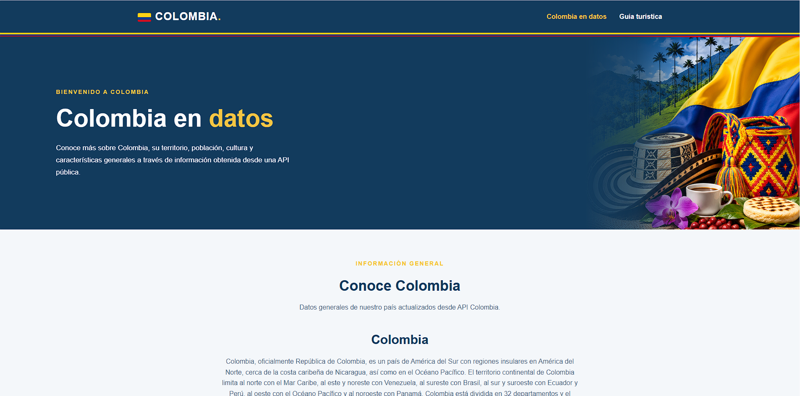
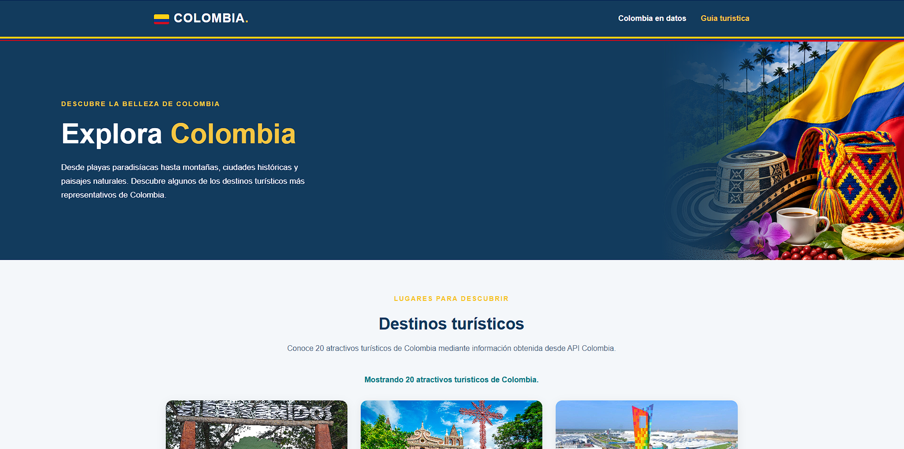
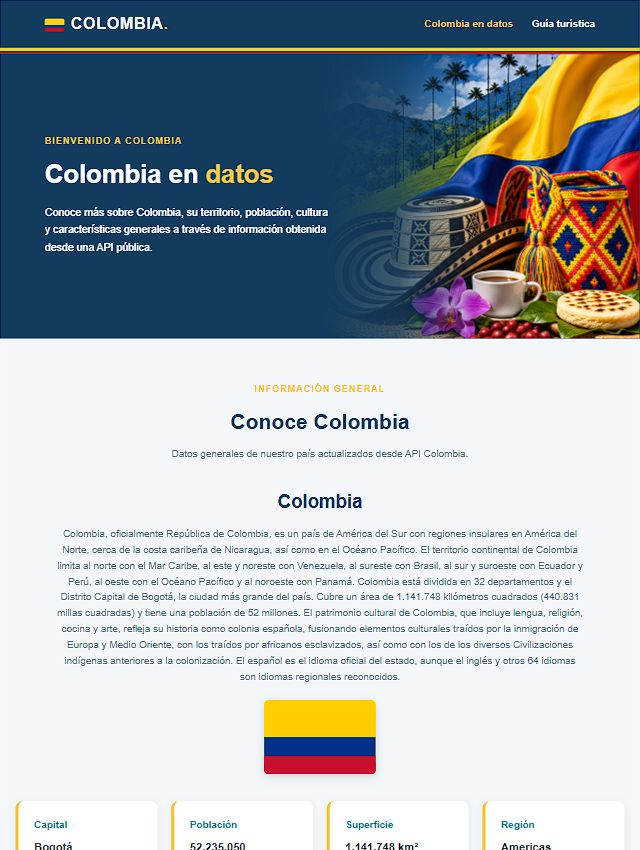
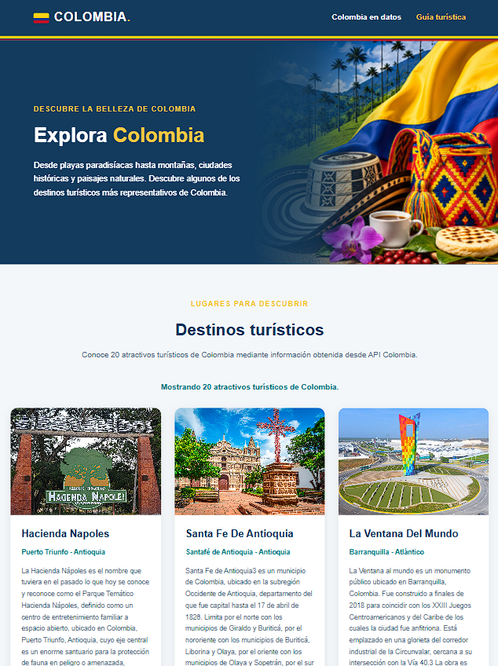
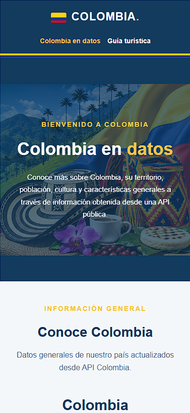
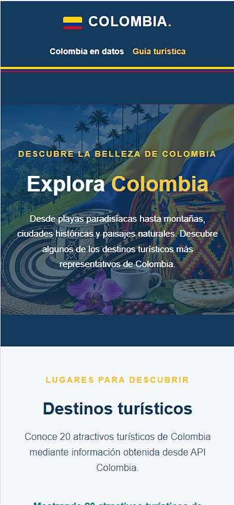

<div align="center">

# BIENVENIDO A COLOMBIA

### Descubre, conoce y explora Colombia

🟨 🟦 🟥

**Mini Portal Web desarrollado con HTML, CSS, JavaScript y API Colombia.**

Un recorrido por la información general, la cultura y los principales atractivos turísticos de nuestro país.

</div>

---

## 🌎 Descripción del proyecto

Este proyecto consiste en el desarrollo de un mini portal web informativo sobre Colombia, utilizando la API pública [API Colombia](https://api-colombia.com/).

El portal permite consultar información general del país y descubrir algunos de sus principales atractivos turísticos mediante el consumo de datos dinámicos con JavaScript y `fetch()`.

El sitio está compuesto por dos páginas independientes conectadas mediante hipervínculos.

## 🗺️ Secciones del portal

### 1. Colombia en datos

Página dedicada a presentar información general de nuestro país:

- 🏙️ Capital.
- 👥 Población.
- 📐 Superficie.
- 🌎 Región y subregión.
- 🗣️ Idiomas.
- 💰 Moneda.
- 🕒 Zona horaria.
- 🧭 Fronteras.
- 🚩 Bandera y otros datos generales.

### 🌴 2. Guía turística

Galería dinámica con los primeros 20 atractivos turísticos de Colombia.

Cada tarjeta presenta:

- 📍 Nombre del atractivo.
- 🏙️ Ciudad.
- 🗺️ Departamento.
- 📝 Descripción.
- 📸 Fotografía del destino.

También se implementan imágenes alternativas para los atractivos cuyas fotografías originales no están disponibles.

---

## 📸 Evidencias del proyecto

Las siguientes capturas muestran la apariencia del portal en diferentes dispositivos.

### 🖥️ Vista de escritorio

**Colombia en datos**



**Guía turística**



### 📱 Vista de tablet

**Colombia en datos**



**Guía turística**



### 📲 Vista de celular

**Colombia en datos**



**Guía turística**



---

## 🛠️ Tecnologías utilizadas

| Tecnología | Utilización |
|---|---|
| 🌐 HTML5 | Estructura y contenido de las páginas. |
| 🎨 CSS3 | Diseño visual y adaptación responsive. |
| ⚙️ JavaScript | Consumo de API y manipulación dinámica del DOM. |
| 🔗 Fetch API | Obtención de información desde servicios externos. |
| 🐙 Git | Control de versiones. |
| 💻 Visual Studio Code | Entorno de desarrollo. |

## 🔌 API utilizada

Se utiliza la API pública de Colombia:

**Sitio web:** https://api-colombia.com/

### Endpoints consultados

**Información general del país:**
```text
https://api-colombia.com/api/v1/Country/Colombia
```

**Atractivos turísticos:**
```text
https://api-colombia.com/api/v1/TouristicAttraction
```

**Departamentos:**
```text
https://api-colombia.com/api/v1/Department
```

## 📂 Estructura del proyecto

```text
API_Colombia/
│
├── css/
│   └── styles.css
│
├── images/
│   └── colombia-hero-art.png
│
├── js/
│   ├── colombia.js
│   └── turismo.js
│
├── evidencias/
│   ├── 01-colombia-en-datos-escritorio.png
│   ├── 02-guia-turistica-escritorio.png
│   ├── 03-colombia-en-datos-tablet.png
│   ├── 04-guia-turistica-tablet.png
│   ├── 05-colombia-en-datos-celular.png
│   └── 06-guia-turistica-celular.png
│
├── index.html
├── turismo.html
└── README.md
```

## 🚀 Instrucciones de ejecución

1. Clonar el repositorio:

```bash
git clone https://github.com/JohanCepeda92/johan-cepeda-api-colombia.git
```

2. Abrir la carpeta del proyecto en Visual Studio Code.

3. Instalar la extensión **Live Server**, si aún no está instalada.

4. Abrir el archivo `index.html`.

5. Hacer clic derecho y seleccionar **Open with Live Server**.

6. Utilizar el menú de navegación para acceder a las dos páginas.

**Nota:** No se requiere instalar dependencias adicionales. Es necesario contar con conexión a internet para consultar las API y cargar los recursos externos.

## ✨ Características principales

- ✅ Dos páginas HTML independientes.
- ✅ Navegación mediante hipervínculos.
- ✅ Consumo de información mediante `fetch()`.
- ✅ Manipulación dinámica del DOM.
- ✅ Mensajes de carga.
- ✅ Manejo de errores mediante `try/catch`.
- ✅ Galería con 20 atractivos turísticos.
- ✅ Fotografías alternativas para imágenes no disponibles.
- ✅ Diseño responsive para escritorio, tablet y celular.
- ✅ Animaciones de entrada.
- ✅ Identidad visual inspirada en los colores, paisajes y elementos culturales de Colombia.

---

<div align="center">

## 👨‍💻 Autor

**Johan Nicolás Cepeda Díaz**

Actividad académica: Mini Portal de Colombia con API.

### Hecho con ❤️ en Colombia

🟨 🟦 🟥

**¡Colombia es un país para descubrir!**

</div>